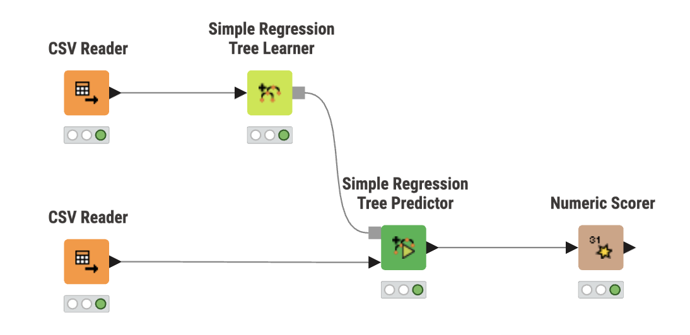
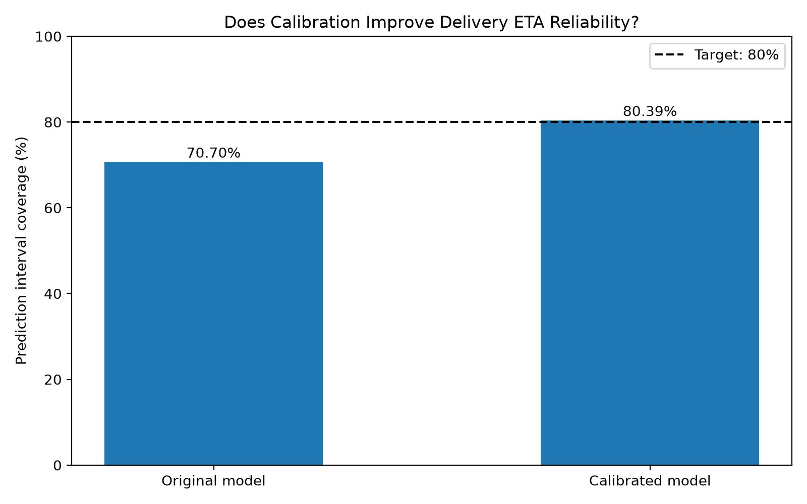
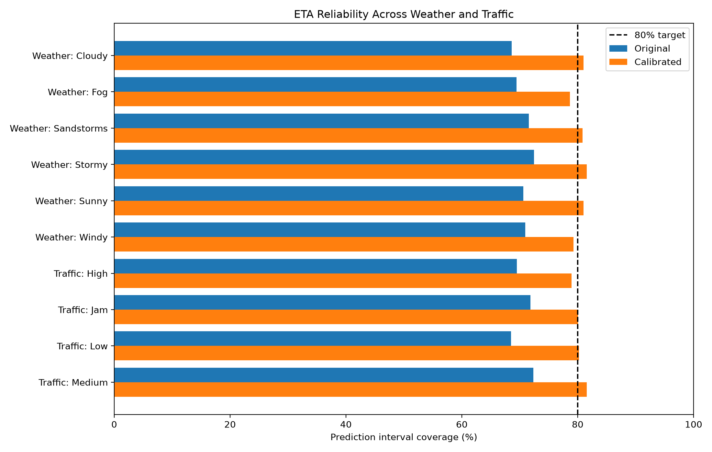

# Can We Trust Food Delivery ETAs?
### Investigating Prediction Reliability, Uncertainty Calibration, and Feature Selection

Food delivery apps provide estimated arrival times, but how reliable are these predictions under different weather and traffic conditions? Can machine learning provide more trustworthy delivery-time estimates by accounting for uncertainty?

This project investigates the reliability of food delivery ETA prediction intervals using LightGBM quantile regression. It examines how performance varies across real-world conditions, evaluates conformal calibration, and studies the effects of removing potentially problematic features.

The goal is not only to predict delivery times accurately, but also to understand **how confidently those predictions should be communicated**.

## Research Questions

1. How reliable are food delivery ETA prediction intervals across different weather and traffic conditions?
2. Can conformal calibration improve prediction interval coverage without making intervals excessively wide?
3. How does removing potentially unavailable or leakage-prone features affect predictive performance?

## Key Findings

### 1. Baseline Prediction Intervals Were Under-Covered

The original LightGBM quantile regression pipeline achieved the following results on the initial test split:

| Metric | Result |
|---|---:|
| P50 Mean Absolute Error (MAE) | 3.18 min |
| P10–P90 Prediction Interval Coverage | 70.36% |
| Intended Interval Coverage | 80% |

A P10–P90 prediction interval is intended to contain approximately 80% of observed delivery times when properly calibrated.

However, the model achieved only **70.36% coverage**, suggesting that its prediction intervals were too narrow or otherwise insufficiently calibrated.

This motivated further analysis of prediction reliability.

### 2. Reliability Varied Across Weather and Traffic Conditions

To investigate whether prediction reliability differed across conditions, I evaluated interval coverage, prediction error, and average interval width for different weather and traffic groups.

Selected findings from the initial test split:

| Condition | Coverage | MAE | Average Interval Width |
|---|---:|---:|---:|
| Cloudy | 70.40% | 2.85 min | 7.70 min |
| Fog | 72.98% | 2.76 min | 7.82 min |
| Sandstorms | 69.41% | 3.30 min | 9.24 min |
| Stormy | 68.42% | 3.43 min | 9.28 min |
| Sunny | 69.16% | 3.14 min | 8.44 min |
| Low Traffic | 67.57% | 2.72 min | 7.26 min |
| Traffic Jam | 71.26% | 3.55 min | 9.92 min |

**Key observation:** Low-traffic deliveries had the lowest average prediction error but also the lowest interval coverage among the reported traffic groups.

This highlights an important distinction: **accurate point predictions do not necessarily imply reliable uncertainty estimates**.

These results describe observed associations rather than causal effects of weather or traffic.

### 3. Conformal Calibration Improved Prediction Interval Coverage

To address under-coverage, I implemented conformalized quantile regression using a separate calibration split.

The method adjusts the original P10–P90 prediction interval boundaries based on errors observed in calibration data.

The calibrated model was evaluated on a separate evaluation split (`new_data`) containing **6,839 orders**.

| Metric | Original | Calibrated |
|---|---:|---:|
| Prediction Interval Coverage | 70.70% | **80.39%** |
| Average Interval Width | 8.79 min | 10.04 min |
| Intended Coverage | 80% | 80% |

The conformal adjustment was approximately **0.62 minutes per side**.

**Results:**
- Coverage increased by **9.69 percentage points**.
- Average interval width increased by **1.25 minutes**.
- Calibrated coverage was close to the intended 80% level.

The improvement demonstrates the tradeoff between prediction reliability and interval width.

Wider intervals can provide better coverage, but they may also give customers less precise arrival-time information.

### 4. Feature Ablation Revealed Small Performance Differences

I also investigated whether removing two potentially problematic features affected prediction performance:

- `pickup_delay_min`: May be unavailable when a customer initially places an order.
- `rider_hist_median_min`: The original training implementation may incorporate information from the same or later delivery outcomes when constructing rider history.

Three model configurations were evaluated on the initial test split:

| Model | Features | MAE | Coverage | Average Width |
|---|---:|---:|---:|---:|
| Original LightGBM | 69 | 3.18 min | 70.36% | 8.77 min |
| Without Pickup Delay | 68 | 3.19 min | 70.11% | 8.68 min |
| Without Pickup Delay and Rider History | 67 | **3.16 min** | **70.67%** | 8.79 min |

Removing both features resulted in a slightly lower MAE and slightly higher interval coverage.

However, these differences were small and were not tested for statistical significance.

The findings suggest that removing these features may be possible without substantially reducing performance on this dataset.

This experiment does not establish that all remaining features are available at order placement or that the model is entirely free from data leakage.

## KNIME Visual Machine Learning Extension

To complement my Python-based ETA reliability research, I developed a beginner-friendly machine-learning workflow using KNIME Analytics Platform.

The workflow demonstrates how to train and evaluate a regression model through visual programming without writing Python modeling code.

### Workflow Overview



The workflow includes:
1. CSV Reader — Load training data
2. Simple Regression Tree Learner — Train a regression model
3. CSV Reader — Load held-out test data
4. Simple Regression Tree Predictor — Predict delivery times
5. Numeric Scorer — Evaluate model performance

### KNIME Regression Results

The model was evaluated on 6,839 test orders using eight input features.

| Metric | Result |
|---|---:|
| Mean Absolute Error (MAE) | 6.314 min |
| Root Mean Squared Error (RMSE) | 7.982 min |
| R-squared | 0.306 |
| Adjusted R-squared | 0.305 |

This experiment provides a simple, interpretable educational baseline.

The KNIME model uses fewer features and a different algorithm than the Python LightGBM model, so their results should not be interpreted as a controlled performance comparison.

### KNIME Certification

I earned the [KNIME L1: Basic Proficiency in KNIME Analytics Platform](https://www.credly.com/badges/47c2adbd-d3eb-40a8-9402-c41d824fe37f) certification in November 2026.

**[View the KNIME workflow, documentation, and reproduction instructions](knime/README.md)**

## Visual Results

### Overall Coverage: Before vs. After Calibration



The calibrated model achieved coverage closer to the intended 80% level on the later evaluation split.

### Coverage Across Weather and Traffic Conditions



Calibration improved observed coverage across the evaluated weather and traffic groups, although results still varied by condition.

## Methodology

The research extends an existing food delivery ETA machine-learning pipeline.

### Baseline Model

- LightGBM quantile regression
- P10, P50, and P90 delivery-time predictions
- Structured delivery-order data
- Evaluation using mean absolute error, quantile coverage, and interval width

### Experiment 1: Conditional Reliability Analysis

Evaluated prediction interval coverage, MAE, and average interval width across weather and traffic categories.

### Experiment 2: Conformal Calibration

Applied a calibration adjustment to existing quantile predictions.

The original test split was used for calibration, while the separate `new_data` split was used for evaluation.

### Experiment 3: Feature Ablation

Trained additional LightGBM quantile models after removing selected features and compared their performance with the original model.

### Experiment 4: Research Visualization

Created visual comparisons illustrating overall calibration performance and differences across weather and traffic conditions.

## My Contributions

This fork adds independent research experiments and analysis beyond the original implementation.

**New contributions include:**

- Weather- and traffic-specific prediction interval analysis
- Conformal calibration of delivery-time intervals
- Model comparisons with selected features removed
- Evaluation of coverage and interval-width tradeoffs
- Research visualizations
- Interpretation of results and methodological limitations
- A pandas compatibility fix in feature engineering
- A beginner-friendly KNIME visual machine-learning workflow with regression modeling, evaluation, and step-by-step technical documentation

### Research Scripts

| File | Purpose |
|---|---|
| `scripts/analyze_interval_coverage.py` | Analyze coverage, MAE, and interval width by condition |
| `scripts/calibrate_eta_intervals.py` | Implement and evaluate conformal calibration |
| `scripts/compare_pickup_delay.py` | Compare models with and without pickup-delay information |
| `scripts/compare_rider_history.py` | Evaluate removing pickup-delay and rider-history features |
| `scripts/plot_research_results.py` | Generate research visualizations |
| `scripts/prepare_knime_data.py` | Generate training and test CSV datasets for the KNIME visual ML workflow |

### Research Outputs

| File | Description |
|---|---|
| `reports/metrics/weather_traffic_analysis.csv` | Weather- and traffic-specific reliability results |
| `reports/metrics/calibration_comparison.csv` | Original versus calibrated interval performance |
| `reports/metrics/pickup_delay_comparison.csv` | Pickup-delay feature ablation |
| `reports/metrics/feature_ablation_results.csv` | Three-model feature ablation comparison |
| `reports/research/RESEARCH_SUMMARY.md` | Research questions, methodology, results, and conclusions |

## How to Reproduce

### 1. Clone the Repository

```bash
git clone https://github.com/charisscchi/food-delivery-eta-research.git
cd food-delivery-eta-research
```

### 2. Set Up the Python Environment

Python 3.12 is recommended for this project.

```bash
python3.12 -m venv .venv
source .venv/bin/activate

python -m pip install --upgrade pip
python -m pip install -r requirements.txt
```

On macOS, LightGBM may also require the OpenMP library:

```bash
brew install libomp
```

### 3. Download and Prepare the Dataset

```bash
python scripts/fetch_data.py

python scripts/run_pipeline.py --stages ingest,validate,features
```

The dataset is downloaded by the original project's data retrieval script.

### 4. Train and Evaluate the Original Model

```bash
python scripts/run_pipeline.py --stages train,evaluate
```

This generates the baseline model artifacts and evaluation results needed for the research experiments.

### 5. Run the Research Experiments

```bash
python scripts/analyze_interval_coverage.py

python scripts/calibrate_eta_intervals.py

python scripts/compare_pickup_delay.py

python scripts/compare_rider_history.py

python scripts/plot_research_results.py
```

Generated CSV results and visualizations are saved in the `reports/` directory.

### 6. Run the Tests

```bash
python -m pytest tests/ -q
```

The original project's test suite passed all 18 tests in the development environment used for this research.

### 7. Reproduce the KNIME Workflow

The KNIME extension uses the same processed dataset with a smaller set of input features.

Generate the KNIME training and test CSV files:

```bash
python scripts/prepare_knime_data.py
```

Then import `knime/Food_Delivery_ETA_Beginner_ML.knwf` into KNIME Analytics Platform.

Follow the [KNIME reproduction guide](knime/README.md) to configure the two CSV Readers and execute the workflow.

## Limitations

Several limitations should be considered when interpreting these results:

1. **Dataset scope:** The experiments rely on a single food delivery dataset. Results may not generalize to other delivery platforms, cities, or time periods.

2. **Calibration assumptions:** Conformal prediction relies on assumptions about the relationship between calibration and evaluation data. Distribution shifts may reduce coverage reliability.

3. **Coverage versus precision:** Improved coverage required wider prediction intervals. Higher coverage alone does not necessarily produce more useful customer-facing estimates.

4. **Feature availability:** Some features may not be available when a customer initially places an order. Further auditing is necessary to establish a valid prediction-time feature set.

5. **Potential data leakage:** The original feature-engineering and evaluation pipeline may contain leakage risks. Removing two selected features does not guarantee that all leakage has been eliminated.

6. **Exploratory evaluation:** Several experiments used an already-examined test split. The later evaluation data also originates from the original project's dataset. Results should therefore not be interpreted as completely independent deployment validation.

7. **Statistical uncertainty:** Small differences between feature ablation models were not evaluated for statistical significance.

8. **Target definition:** The precise definition of delivery time and the timing of available input information require further verification before interpreting this system as a real-time, order-placement ETA predictor.

## Future Work

Potential extensions include:

- Auditing all features for availability at prediction time
- Evaluating conformal calibration on the reduced-feature model
- Implementing leakage-safe, time-aware rider-history features
- Testing models across additional datasets and time periods
- Investigating condition-specific or adaptive prediction intervals
- Comparing interval coverage and width using additional evaluation methods
- Developing an interactive interface to visualize delivery-time uncertainty

## Conclusion

This research investigated the reliability of machine-learning food delivery ETA predictions, focusing on prediction intervals rather than point estimates alone.

The baseline LightGBM model exhibited under-coverage, and prediction reliability varied across weather and traffic conditions.

Conformal calibration improved observed interval coverage from **70.70% to 80.39%** on the later evaluation split, with an increase in average interval width of **1.25 minutes**.

Feature ablation experiments also showed that removing two potentially problematic features produced only small changes in prediction performance.

Overall, the findings highlight the importance of evaluating **predictive accuracy, uncertainty calibration, and feature validity** when developing practical machine-learning systems.

## Acknowledgments and Attribution

This research builds upon [SilaShiva/delivery-eta-quantile](https://github.com/SilaShiva/delivery-eta-quantile), which provides the original data-processing, model-training, and evaluation pipelines.

My independent extensions focus on prediction interval reliability, conformal calibration, feature ablation, research visualizations, and interpretation of findings.

The original MIT license and copyright attribution are retained.
