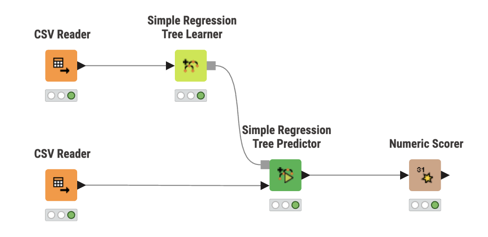

# Food Delivery ETA Prediction with KNIME

## Overview

This workflow demonstrates how to build and evaluate
a simple machine-learning model using KNIME Analytics
Platform without writing Python modeling code.

It complements the Python-based Food Delivery ETA
Reliability and Calibration Research project.

## Research Question

Can a beginner use visual machine learning to
predict food delivery times?

## Workflow

### Workflow Overview



This workflow demonstrates a visual machine-learning pipeline, from importing training and test data to training a regression tree, generating predictions, and evaluating model performance.

The workflow contains five nodes:

1. CSV Reader — Load training data
2. Simple Regression Tree Learner — Train the model
3. CSV Reader — Load test data
4. Simple Regression Tree Predictor — Generate predictions
5. Numeric Scorer — Evaluate model performance

## Dataset

The workflow uses the existing project's processed
food delivery dataset.

Selected features include:

- Delivery distance
- Rider age and rating
- Order hour
- Weather
- Traffic density
- Vehicle condition
- Number of deliveries

Target variable: `time_taken_min`

The workflow excludes pickup-delay and rider-history
features used in the original Python model.

## Results

| Metric | Result |
|---|---:|
| Mean Absolute Error (MAE) | 6.314 min |
| Root Mean Squared Error (RMSE) | 7.982 min |
| R-squared | 0.306 |
| Adjusted R-squared | 0.305 |

These results were obtained using a simple regression
tree evaluated on 6,839 test orders.

This is an educational baseline, not a controlled
comparison with the Python LightGBM model.

## How to Reproduce

### 1. Prepare the dataset

From the repository root, activate the Python
environment and run:

```bash
python scripts/fetch_data.py
python scripts/run_pipeline.py --stages ingest,validate,features
python scripts/prepare_knime_data.py
```

This generates:

- `data/knime_demo/knime_train.csv`
- `data/knime_demo/knime_test.csv`

The generated datasets are not committed to GitHub.

### 2. Import the KNIME workflow

Open KNIME Analytics Platform and import:

`Food_Delivery_ETA_Beginner_ML.knwf`

### 3. Configure the CSV Readers

The exported workflow contains local CSV references.
These must be updated to match your computer.

For the first CSV Reader, browse to:

`data/knime_demo/knime_train.csv`

For the second CSV Reader, browse to:

`data/knime_demo/knime_test.csv`

The paths above show where the generated CSV files are located within the repository. Use each CSV Reader's file picker to select the corresponding file on your computer.

### 4. Execute the workflow

Reset the nodes if needed, then execute the workflow.

The Numeric Scorer reports the model's regression
performance on the test dataset.

## What This Project Demonstrates

- Visual machine-learning workflows
- Data preparation and feature selection
- Training a regression tree
- Evaluating predictions on separate test data
- Interpreting MAE, RMSE, and R-squared
- Communicating machine-learning results to beginners

## Limitations

- This is a simple educational regression baseline.
- The workflow currently requires users to select
  their locally generated CSV files.
- The model uses fewer features than the Python
  LightGBM pipeline.
- The dataset's target definition and remaining
  feature availability require further auditing.
- Results should not be interpreted as a direct
  controlled benchmark against LightGBM.
